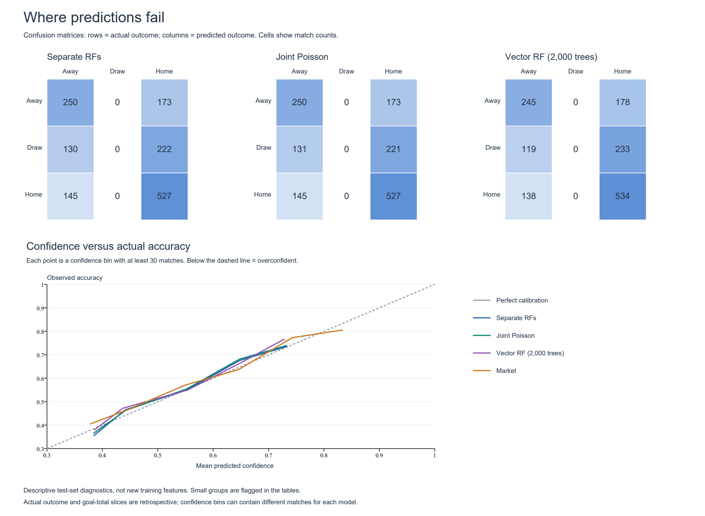

# Football score prediction and betting backtests

**Current evaluation policy:** Training OOB reports, manual-filter results, CSVs
and profit curves are restored alongside the held-out test results. Each OOB
prediction uses trees that omitted that match, but may use later seasons; it is
a diagnostic, not a chronological backtest. The test set has also been inspected
during strategy comparisons. Compare net profit, amount staked and ROI; manual
results include flat-$1 profit on exactly the same selected bets to assess sizing.
The old automated strategy-search endpoint remains retired, and its archived
results are exploratory. Model training and live inference are unchanged.

Predict home and away football goals, convert the score predictions into match-outcome probabilities, and compare betting decision rules on recorded odds.

The current experiment compares two separate random forests, a single **2,000-tree multi-output random forest**, and a bivariate Poisson calibration layer. It also examines where predictions fail and whether probability-based betting rules produce positive historical returns.

## Start here

### Position-based matchups

The [positional experiment](docs/positional-matchups.md) uses matched starters'
preferred FIFA positions to compare attack against opposing defense/goalkeeper
and midfield against midfield. Run `python scripts/prepare_positional_features.py`
then `python scripts/compare_positional_matchups.py` for chronological Poisson
and random-forest comparisons with the original and whole-team-attribute models.
Results and saved predictions are under `results/positional_matchups/`.

The [four-improvement experiment](docs/lineup-improvements.md) adds stronger
identity matching, deviations from prior club lineups, independent unit weights
and monthly FIFA-prior player updates. Run `prepare_lineup_improvements.py`,
`prepare_dynamic_lineups.py`, then `compare_lineup_improvements.py` from `scripts/`.
Its isolated results are under `results/lineup_improvements/`.

For [direct home-win versus non-win classifiers](docs/binary-home-win.md), run
`python scripts/train_binary_home_win.py`. This trains binary logistic and
random-forest models and compares them with the existing goal-based
probabilities. Outputs are in `results/lineup_improvements/binary_retrained/`.

### Live predictions and local interface

Run `python run.py model-app` and open **http://127.0.0.1:8767/** for
**Upcoming outcome picks**, also available at **http://127.0.0.1:8767/lineups/**.
The default view shows qualifying picks. Refresh the next 14 days to see expected or
confirmed starters, EA ratings when available, and XGBoost home/draw/away probabilities.
The view uses the original 2014–22 goal-vector
model and saved Bet365 prices. Filtered variance risks one unit when the chosen
price is 4–1000 and expected return exceeds 2%. Each fixture shows its decision
or the reason inputs are missing.
Qualifying, skipped and awaiting-input counts appear above the fixtures. Select
**Awaiting inputs** to see missing prices or lineup details. Each qualifying pick
shows the selected outcome, its probability, Bet365 price, expected return and
flat stake.

The unified model/strategy interface starts with `python run.py model-app` at
**http://127.0.0.1:8767/lab/**. Choose expanded RF, OLS, Poisson, ordered logit or
ordered probit and any of the 15 fixed strategies. Regression variants retain
FIFA, all form/prior fields, odds and numeric matchweek, with optional home/away
club identities. Exact active inputs are visible. Selections are recomputed from
shared saved feature audits; refresh fetches new inputs into `results/model_strategy/live/`.
The page pairs each model with its own all-training in-sample and test histories,
plus separate RF OOB, at fixed $1–$5 stakes. It does not replace the earlier manual-filter interface.
The unified page now includes manual odds range, minimum expected return, outcome,
flat/five-level staking, score-step width and editable stake amounts. Apply filters
recalculates live picks, CSV exports and training/test curves with the same rules.
The filtered Legacy preset's thresholds are overridden by these explicit controls.
Historical strategy selections are cached per model/data hash on first custom use.

The expanded RF has a separate interface at **http://127.0.0.1:8766/**:

```bash
python scripts/build_expanded_interface.py
python run.py app --expanded --port 8766
```

It uses the expanded vector forest trained on 19,263 matches from 2008–09
through 2021–22, including 7,702 eligible older matches with FIFA ratings.
Manual filters, editable stake levels, and cumulative profit by league use this
model's own training OOB predictions and the 1,447-match 2022–23 test set.
OOB is not a chronological backtest. The initial preview recomputes predictions
from saved live inputs; **Refresh & predict** fetches current inputs and runs
the expanded model. Its outputs are isolated under `results/expanded_interface/`.
The original interface remains available on port 8765.

To reproduce ordered-model and training-only feature-selection comparisons:

```bash
python -u scripts/compare_ordered_models.py
python -u scripts/select_expanded_features.py
```

The second experiment selects among nine predefined feature sets separately
for OLS, Poisson (fixed alpha 0.01), ordered logit and ordered probit. Validation
seasons are 2019–20, 2020–21 and 2021–22; each fold fits preprocessing and models
using strictly earlier seasons. A one-standard-error rule favors smaller models.
Choices are saved before loading the 2022–23 test set, then models are refitted
on all expanded training rows. Results, feature lists, fold scores, fitted models,
and strategy comparisons are saved under `results/feature_selection/` and appended
to the existing `/expanded-comparison/#feature-selection` report. This is an
exploratory comparison on a previously inspected test season, not a guarantee
against overfitting or a change to the live RF.

`python -u scripts/compare_team_identity.py` retains FIFA means, all eight
form/prior fields, odds and matchweek for each regression family, then compares
with and without separate home/away club identities. Both versions are saved;
no simplicity rule drops requested inputs. It reuses the matching forward-season
validation scores and fits all eight models on expanded training data. Results
are in `results/team_identity/` and `/expanded-comparison/#team-identity`.

`python -u scripts/report_training_gains.py` adds cumulative gains across all
19,263 training matches and the test season for those eight regressions and RF.
Use `/expanded-comparison/#training-gains` to switch strategies and team variants.
Fitted training predictions are explicitly in-sample; RF OOB is a separate curve.
The report includes ROI and training/forward-validation/test loss diagnostics.

The live workflow downloads expected/confirmed lineups from RotoWire, current EA
overall ratings, and results/Bet365 odds from Football-Data. It feeds lineup rating
summaries and pre-match form into the **existing 2,000-tree random forest** and
exports home/draw/away probabilities and goal counts. No API key is required.
See [integration details and limitations](docs/live-lineup-integration.md).

```bash
# Launch the interface, then open http://127.0.0.1:8765
python -m pip install -r requirements-live.txt
python run.py app

# Or collect data and predict directly from the command line
python run.py predict
python run.py predict --model lineup_rf --leagues E0 SP1 --days 14

# Repeat using already downloaded source files
python run.py predict --offline

# Check parsing, date isolation, probabilities, and exports without network access
python scripts/test_live_predictions.py
python scripts/test_lineup_integration.py
```

Choose leagues and click **Refresh & predict** in the interface. Supported leagues:
Premier League (`E0`), La Liga (`SP1`), Bundesliga (`D1`), Serie A (`I1`), and Ligue 1
(`F1`). Outputs and source caches are saved under `results/live/`; the interface
can reload the last successful run. Stop the server with Ctrl+C. Use `--port 8766`
if the default port is occupied. Run one pipeline at a time against this directory.

**Strategy selections** compares all 14 existing backtest rules, including the
binary home-win/home-loss and home-or-skip rules. Choose a rule or **All strategies**
to see its selection, decimal odds, actual model probability, expected net profit
per unit, and stake split. Synthetic double-chance prices are explicitly labeled.
Missing odds produce **Unavailable**; threshold failures produce **Skip**. Each
strategy is an alternative, and one unit means one total stake per match. This
does not place bets. Export all rows using **Download all strategy selections**.
To add strategies to an existing saved run without downloading again, execute
`python src/live_bets.py`. Validate the rules with `python scripts/test_live_bets.py`.

The default **Lineups + EA ratings** mode requires 22 uniquely matched starters,
Bet365 odds, and the saved model with matching training metadata. It withholds
fixtures with missing inputs, shows their reasons, and exposes each predicted
XI and its ratings. Matchweeks may be explicitly labeled estimates; official
overrides are supported. Predicted lineups and current launch ratings are not
identical to the historical model's training inputs, so live accuracy is unverified.

The optional **results-only Poisson baseline** remains available with
`python run.py predict --model poisson`. This mode needs only the standard library.
It uses home/away scoring and conceding rates, exponentially weighted with a
180-day half-life and shrunk toward league averages using eight pseudo-matches.
It needs no FIFA ratings, injuries, lineups, or odds. The interface reports
walk-forward accuracy and log loss on up to 60 recent matches per league, with
a league-average Poisson comparator. At least 100 earlier matches are required
for evaluation. These checks do not establish that the model is profitable or
better than the existing forest.

Only fixtures supplied by the provider can be predicted; its CSV is a limited
upcoming list, not the entire future season. An empty list is reported explicitly.
Dates use the current UTC date, source times are displayed verbatim, and today's
fixtures may already have started. Training excludes today's results. Historical
files for the requested seasons must all download successfully; failures do not
silently substitute stale cache files. Offline mode explicitly uses cached files.
Source timestamps and hashes are stored in `predictions.json`. Small team samples
are flagged. The modal score and expected goal counts are different quantities;
predicted goal counts are not shot-based xG.

- [Main notebook](notebooks/prediction_bivariate.ipynb): saved results, model code, plots, and error analysis.
- [HTML report](results/report.html): download and open locally with the other files in `results/`; GitHub displays its source.
- [Model metrics](results/model_metrics.csv) and [strategy results](results/strategy_results.csv).
- [Methodology and limitations](docs/methodology.md).



## Current experiment

The existing split contains **11,561 usable training matches** and **1,447 test matches** after removing seven incomplete training rows. All models use the same test matches. The vector forest uses squared-error loss, 2,000 trees, depth 5, `max_features=0.3`, and `max_samples=0.5`.

| Model | Correct outcomes | Accuracy | Outcome log loss ↓ |
|---|---:|---:|---:|
| Separate random forests | 777 / 1,447 | 53.70% | 0.97879 |
| Bivariate Poisson, exact probabilities | 777 / 1,447 | 53.70% | 0.97883 |
| Single vector-output forest | 779 / 1,447 | 53.84% | 0.97884 |

The RF-based models never select a draw as their most likely outcome in this test set, despite assigning nonzero draw probabilities. Closely matched teams are also harder to predict. The notebook includes confusion matrices, calibration, team-level errors, goal errors, and individual wrong predictions.

### Betting results are exploratory

Each backtest stakes one unit per match unless the rule explicitly skips a bet. Reported profit is net of the stake. For the vector forest:

| Binary decision rule | Most-likely-side profit | Square-root-profit-weighted profit |
|---|---:|---:|
| Home wins vs. does not win | −75.32 units | +78.44 units |
| Home loses vs. does not lose | −62.62 units | −188.93 units |

Square-root-profit weighting chooses the largest `probability × sqrt(decimal_odds − 1)`. Double-chance payouts are **synthetic split-stake payouts**, not quoted market prices. A synthetic payout at or below one receives zero weight in that rule.

These strategies were explored repeatedly on the same test set. Positive returns are not independent confirmation of a profitable strategy. A fresh, chronologically held-out evaluation is needed before making that claim.

## Setup

Use **Python 3.12**. From the repository root:

```bash
python -m venv .venv
# Windows PowerShell:
.venv\Scripts\Activate.ps1
# macOS/Linux instead: source .venv/bin/activate
python -m pip install -r requirements.txt
```

To open notebooks interactively:

```bash
python -m pip install -r requirements-notebooks.txt
python -m jupyter lab
```

Open `notebooks/prediction_bivariate.ipynb`. Its embedded outputs can also be viewed on GitHub without installing anything. The saved model binary is optional: when absent, the notebook displays committed per-match predictions unless you explicitly choose to retrain.

## Reproduce

```bash
# Rebuild tables, plots, report, and notebook from saved predictions; no training:
python run.py report

# Refit models on data/train.csv and evaluate data/test.csv, then rebuild the report:
python run.py train

# Check Python/notebook syntax, probabilities, metrics, and strategy accounting:
python run.py check
```

The report command reconstructs the ignored betting ledgers from `results/match_predictions.csv`. The train command writes a local `results/vector_forest.joblib`; the model and detailed ledgers are intentionally ignored by Git. The report command does **not** evaluate newly edited model code—run `train` for that.

## Repository layout

```text
data/                 Existing CSV inputs and historical league tables
docs/                 Methodology, data notes, and legacy workflow notes
models/legacy/        Original saved estimators and encoders
notebooks/
  prediction_bivariate.ipynb   Current experiment
  legacy/             Original exploratory notebooks
results/              Curated metrics, predictions, figures, and report
scripts/              Project verification
src/                  Training, evaluation, reporting, and shared helpers
run.py                Train / report / check entry point
requirements.txt      Current workflow dependencies
```

Historical data and model files were preserved during cleanup. The repository still contains about 152 MB of pre-existing tracked material; restructuring does not reduce Git history. See [data notes](docs/data.md) before redistributing the datasets, and [legacy notes](docs/legacy.md) before running older notebooks. No software or dataset license has been selected by this cleanup.
# Five-level dollar staking

The interface adds a separate staking gate to all 14 original selections: skip
nonpositive model expected value, then rank positive selections by the Kelly score
`(probability * odds - 1) / (odds - 1)`. Fixed score bands `(0,1%]`, `(1%,2%]`,
`(2%,3%]`, `(3%,4%]`, and `>4%` map to $1, $2, $3, $4, and $5 total per match.
These are ranking bands, not percentages of a bankroll. Amounts can be edited in
the interface; edits affect the displayed live and historical dollar amounts only.
CSV exports retain the default $1–$5 amounts. Synthetic legs split the total stake.

Run `python scripts/backtest_stake_levels.py` to rebuild season/level summaries and
the full ledger in `results/stake_level_*`. Training results use the saved vector
forest's out-of-bag predictions; test results use held-out `RF_vector` predictions.
OOB is not a chronological walk-forward evaluation. Historical inputs use actual
lineups and differ from live projected lineups. Season labels are uniquely matched
to source season tables; unmatched or ambiguous model rows stop the build.
The fixed thresholds are not selected to maximize historical profits.

The history panel reports total stakes, gross returns (including returned stakes),
net profits, ROI, and the original flat-$1 strategy comparison. This is hypothetical
accounting with no compounding, bankroll limit, fees, or cent rounding of synthetic
legs. The project has already inspected its test set in previous analyses.
Check boundaries and reconcile every ledger row with the summaries using
`python scripts/test_stake_levels.py`.

Historical charts in the interface follow the selected strategy and edited dollar
stakes. Select All strategies to compare train/test ROI, or a single strategy for
season net profits. Run `python scripts/plot_stake_history.py` after rebuilding the
backtest to export the default $1–$5 figures as `results/stake_history_*.png` and
SVG. Exported figures use the saved amounts, not unsaved browser edits.

Run `python scripts/plot_stake_cumulative.py` after rebuilding the backtest to
generate cumulative profit curves for all strategies and the exported
`results/stake_cumulative_profit.png`. Each curve starts at zero and settles
all bets within each season/matchweek together. Exact kickoff dates are absent,
so these are matchweek-ordered profit curves, not daily bankroll histories.
The builder verifies all 28 final curve values against the historical summaries.

## Fixed-model strategy search

`python scripts/search_betting_strategies.py` searches 2,240 flat-stake combinations
of 14 existing rules, raw/logistic-calibrated probabilities, five minimum edges,
four odds bands, and four outcome filters. Calibration uses 2014–18 OOB rows;
selection uses 2018–20; 2020–22 is an audit period; previously inspected 2022–23
test results are reported separately. Shortlisted flat rules also test three
Kelly band widths (1%, 2.5%, 5%) with $1–$5 stakes. No live settings change.

This isolates strategy selection using the saved model. Its OOB trees still
contain later training seasons: it is **not** a leakage-free chronological
model backtest. Search winners may fail on later periods. The HTML report at
`/strategy-search`, JSON, full search CSV and finalist CSV are written under
`results/strategy_search*`. Run `python scripts/test_strategy_search.py` to audit
selection independence from holdout metrics and reconcile period accounting.

The main selector also includes **Legacy variance — filtered search candidate**,
selected by default. It preserves the original variance-score choice, then skips
unless decimal odds are 4–1000 and raw lineup-RF expected return is strictly above
2%. Stakes use the original 1%-wide Kelly levels and editable dollar amounts.
Poisson-baseline reports mark this candidate unavailable. The original 14 rules
remain available. Historical tables, curves and CSVs include the candidate;
all-training totals cover 2014–22, while the search report separates selection
(2018–20), audit (2020–22), and test (2022–23). Rebuild both the stake backtest and
cumulative curves after a model/data change. `scripts/test_filtered_strategy.py`
checks integration and exact agreement with the frozen search results.

## Manual interface filters

### Direct RF, adjusted form and richer lineups

Run `python scripts/prepare_classifier_features.py` then
`python scripts/train_classifier_models.py`. The preparation recovers player
ratings from the original processed season files and older player-rating audit,
verifies their aggregates against the existing rows, and joins actual fixture
dates from public Football-Data archives. Original train/test rows and targets
are preserved, including known data issues recorded in `results/classifier/feature_audit.json`.
Three training rows have ten rated starter slots on one side; coverage counts
are explicit. There is one duplicate test fixture with different saved lineups,
and one training-score discrepancy between the original and dated result sources.

Four fixed 2,000-tree classifier ablations use existing RF features, those features
plus opponent-adjusted form, plus richer lineup summaries, and both additions.
The classifier predicts H/D/A directly. Other forest settings follow the existing
goal-vector RF; the classification split criterion is log loss. Adjusted form
uses actual points minus expected points from normalized inverse past odds,
with last-five averages, season averages, expected-point averages and counts.
All same-day outcomes are excluded; source season labels preserve COVID seasons.
Lineup additions are top/bottom-three means, median, IQR, coverage counts and
home/away advantages. These are not verified positional or injury features.

Folds predict 2019–20, 2020–21 and 2021–22 from earlier seasons; final fits use
all 19,263 training rows. Every variant is reported, with no test-based feature
selection. Each has a separate forward-prediction temperature calibrator.
Test 2022–23 remains previously inspected. Select the four **RF classifier**
entries in port 8767 to use them with each strategy and league filter. Their
ablation uses equal training weights and has no OOB curve. Live adjusted-form
inputs require verifiable cached current-season results; missing provenance
withholds a fixture instead of substituting historical training-era state.
Run `python scripts/test_classifier_models.py` for causal-feature and inference checks.

### Team skill comparisons and feature selection

```bash
python scripts/prepare_team_attributes.py
python scripts/compare_team_attributes.py --trees 500
python scripts/test_team_attributes.py
```

This experiment uses the existing named starting lineups and season-edition FIFA
files to compare pace, shooting, passing, dribbling, defending and physicality.
Each attribute has home/away outfield means, coverage counts and a home-minus-away
difference. Matchup features compare each side's shooting, dribbling and pace with
the opponent's defending. Goalkeepers are excluded from outfield means. At least
eight verified outfield values are required; missing values remain missing until
training-fold median imputation. Names must match uniquely, and the player's
overall rating must agree with the original lineup pipeline. The player-level
matching audit records exclusions and matching methods.

The comparison covers the same available Spain/Germany/Italy fixtures from
2014–15 onward for every variant. EPL source files lack player names; the
pre-2014 expanded rows lack these subratings. Neither is silently assigned
invented attributes. Ambiguous duplicate test fixtures are excluded. Full
attribute coverage and partial coverage are reported separately.

RF outcome classification and RF goal regression each compare the original
predictor set with individual attribute groups and combined groups. Both use
500 trees by default and otherwise the established forest settings; baselines
are refitted on exactly the same samples. Feature selection uses forward
2019–20 and 2020–21 folds, with a one-standard-error simplicity rule that can
choose the baseline. Choices are saved before the 2021–22 audit and previously
inspected 2022–23 test evaluations. Encoders and imputation are fitted inside
each fold. There is no betting-profit selection.

See `results/team_attributes/report.html`, `metrics.csv`, `selection.json`,
`selection_scores.csv`, `coverage.csv` and `feature_audit.json`. Models and
predictions are saved separately from active interface models. FIFA snapshot
publication times are unverified, so this is exploratory historical evidence,
not a verified live backtest. Downloaded extra seasons are not automatically
included in this experiment.

For OLS, Poisson, ordered logit and ordered probit, run:

```bash
python scripts/compare_attribute_regressions.py
python scripts/test_attribute_regressions.py
```

This comparison also allows feature removal: 22 predefined sets range from all
68 original/skill predictors to compact combinations, individual skill gaps
plus odds, and odds alone. Team identities, redundant overall summaries, form,
matchweek and skill groups can be omitted. Selection uses only forward
2019–20 and 2020–21 scores. Among candidates within one standard error of the
best mean log loss, it prefers fewer encoded columns, then fewer raw columns.
This is a finite feature-set search, not exhaustive subset search. Both the
minimum-loss candidate and the simpler selected candidate are evaluated later.
All preprocessing is fitted on earlier training rows; SVD removes exact
collinearity for the ordered models. Poisson retains alpha=0.01.

The regression report in `results/team_attributes/regressions/report.html`
compares original predictors, all added attributes, and selected smaller models
on identical audit/test matches. `comparison.csv` lists feature counts and
retained predictors, `selection.json` freezes the choices, and `metrics.csv`
includes convergence diagnostics, probability metrics and goal errors where
applicable. Selected models are saved separately; active interface models are
not replaced by this exploratory comparison.

For coefficient-level Poisson lasso selection, run:

```bash
python scripts/poisson_lasso_cv.py
python scripts/test_poisson_lasso.py
```

The lasso experiment starts with all 68 original/skill inputs, then penalizes
individual encoded coefficients with L1. It fits separate home/away goal
equations, with unpenalized intercepts. All numeric columns, team dummies and
missing indicators are standardized within each training fold; the lasso
design is not rotated by SVD. Thirteen penalties from 0.0001 to 1 are compared
on forward 2017–18, 2018–19, 2019–20 and 2020–21 folds. Each target independently
selects its minimum mean Poisson-deviance penalty and the strongest penalty
within one standard error of that minimum. Both fixed choices are evaluated on
2021–22 and the previously inspected 2022–23 test. Outcome log loss is reported
after converting the goal means to home/draw/away probabilities.

The solver uses nonnegative coefficient splitting with SciPy L-BFGS-B and
checks the original L1 optimality conditions for every fit. Zero-penalty,
strong-penalty, collinearity and fold-preprocessing tests guard the implementation.
This is actual L1 shrinkage, distinct from the earlier PoissonRegressor's L2
penalty and predefined group selection. Correlated variables can substitute
for one another, so retained coefficients are not causal feature rankings.
See `results/team_attributes/poisson_lasso/report.html`, `cv_scores.csv`,
`selection.json`, `metrics.csv` and `retained_coefficients.csv`. Both selected
models are saved separately from active interface models.

### Recent-data weighting

Run `python scripts/train_recent_models.py` after calibration to compare equal
weights with exponential 3-season and 6-season half-lives for all nine models.
Weights are normalized to mean one; earlier seasons have less influence. RF,
linear and Poisson fits receive sample weights; ordered models optimize a
weighted likelihood with its analytic gradient. Form/prior predictors are retained.
Weight strength is selected using mean seasonal log loss on forward predictions
for 2019–20 and 2020–21, then audited on 2021–22. Equal weights can win. Models
are refitted on all 19,263 training matches only after selection; 2022–23 is
evaluated afterwards and remains an already-inspected test. Earlier model and
feature decisions also used these historical seasons, so this is exploratory.

In port 8767, **Training weights** switches between original models and the
chronologically selected configuration. Every strategy, league filter, export
and profit curve follows that choice. Weighted models have their own calibration
parameters fitted to their forward predictions; old temperatures are not reused.
Training curves are in-sample. Weighted-mode RF OOB is omitted; use the forward
audit to assess generalization and original equal-weight mode for existing OOB.
Metrics, selected half-lives and effective sample sizes are in `results/recency`.
Run `python scripts/test_recent_models.py` for decay, gradient and inference checks.

### Calibration procedure

Run `python scripts/calibrate_models.py` to refit chronological folds and fit
one temperature per expanded RF / linear / Poisson / ordered model variant.
Each fold predicts 2019–20, 2020–21 or 2021–22 using only earlier seasons, with
preprocessing refitted inside that fold. Calibration on the first two folds is
audited on the third; the final temperature uses all three folds. The existing
full-training model plus this temperature is evaluated on 2022–23, which has
already been inspected and is not a fresh holdout. Transfer from earlier fitted
models to the full-data model is an assumption. Existing model specifications
were developed in earlier experiments; this is a temporal calibration audit,
not a fully untouched evaluation of the entire research process.

In port 8767 choose **Probabilities → Calibrated (temperature scaling)**.
Selections, exports, stake levels and league profit curves use those probabilities.
Expected goals do not change. Training curves remain in-sample; calibrated RF
OOB is omitted because the calibrator has seen outcomes within the training era.
The interface reports raw versus calibrated forward-audit and test log loss,
multiclass Brier score and AUC. Full metrics and reliability bins are saved in
`results/calibration/`. Run `python scripts/test_probability_calibration.py`
to check fitting, temporal fold usage and interface consistency.

The unified `python run.py model-app` interface (port 8767) also supports a league
filter: all leagues, Premier League, La Liga, Bundesliga or Serie A. It applies to
fixture selections, CSV exports and historical results for every model/strategy.
League tables and cumulative profit curves separate in-sample train, RF OOB and
test results. Prediction-quality diagnostics still cover all leagues.

The main interface's **Manual strategy filters** panel accepts any original rule,
minimum expected return (strict), inclusive minimum/maximum decimal odds, outcome
filter, flat or five-level staking, Kelly band width and five dollar amounts.
Click **Apply filters & recalculate** to update live choices, season tables and
cumulative curves. Downloaded selections include the applied filter values.
Filters operate on each rule's chosen outcome; they do not reselect a different
outcome when it fails a filter. Flat stakes use the level-1 amount. Live predictions
remain unchanged; history always uses the saved lineup RF and historical Bet365
odds. Both the training OOB limitation and historical strategy-search overfitting
still apply. Run `python scripts/test_manual_filters.py` for parity and boundary
checks. Alternative source UI is deferred; the active manual endpoint accepts
Bet365 only. Winner and Polymarket public reads returned HTTP 403 during research.


### Winner Israel in the model interface

At port 8767, choose **Odds source → Winner Israel** and enter full-time 1/X/2 decimal prices for each matched fixture. Confirm the market, then apply filters. Quotes expire after 15 minutes. Stakes and exports use ILS; values are not converted from USD. The saved models retain their original Bet365 input features; Winner quotes only change strategy selection and payout calculations. Missing or invalid quotes withhold the selection. No Winner historical curves are produced from Bet365 data. Verify minimum stakes and single-bet eligibility on Winner. Automatic retrieval is not implemented: the public website rejected the research request with HTTP 403.

The interface also links research on fractional Kelly, risk-constrained Kelly, robust Kelly, probability uncertainty, and joint portfolio allocation. These are research candidates, not newly implemented strategies.

Validation: `python scripts/test_winner_models.py` checks quote validation, stale quotes, input-odds separation and absence of substituted historical returns.


### Bankroll strategy comparisons

Open `/bankroll-backtest/` on port 8767. Run `python scripts/backtest_bankroll_models.py` to rebuild all 44 saved configurations (raw/calibrated, equal/recency, regression team/no-team variants, and four direct classifiers). The page compares flat $1, quarter Kelly and robust quarter Kelly, with train/test cumulative profit graphs and all four leagues.

Each split/league starts with an independent $1,000. All methods select the same highest-positive-EV H/D/A outcome and use a 2% per-match and 10% daily exposure cap. Stakes are reserved before same-date settlement. Robust Kelly uses the worst-case selected-outcome probability in a fixed +/-2 percentage-point interval, followed by quarter Kelly; this radius is a prespecified sensitivity assumption, not a fitted confidence bound. Historical Bet365 prices only. No live bets or Winner backtests. Main-interface manual filters do not affect this separate experiment.

The all-league portfolio is simulated independently; it is not the sum of independent league portfolios. Curves show weekly closing snapshots from a daily simulation, and max drawdown uses daily closes. Train is in-sample, test has previously been examined, original duplicated test fixture retained, and fractional stakes ignore real-world minimums/fees. `results/bankroll_backtest/summary.csv`, `results.json`, `plan.json` and compressed `ledger.csv.gz` contain auditable results. Ledger source_row is the position within its split/league subset.

Run `python scripts/test_bankroll_backtest.py` for formula, robust-abstention, exposure and settlement checks.


### Automatic Winner odds

Choose **Odds source → Winner Israel · automatic download** on port 8767. The app requests Winner's public `GetCMobileLine` feed with the public request metadata used by its website; no login or betting endpoints are used. Requests cache for 60 seconds, refresh every five minutes while the interface is visible, and can be triggered with Download Winner odds now. The app must have network access.

Only upcoming, non-live, full-time football 1/X/2 markets from E0/SP1/D1/I1 are accepted. Hebrew team names use explicit aliases. Matching requires league, date, home and away; duplicates or unknown aliases are withheld. Prices expire after five minutes or at kickoff. Missing/download failures never substitute Bet365 prices. Bet365 remains a model input; Winner is the execution-odds source. Refresh shared match inputs when the model fixture cache is out of date.

`python scripts/download_winner_odds.py` downloads independently. Parsed prices are in `results/winner/latest.json`; original responses are archived in `results/winner/snapshots/` to establish a future quote history. These snapshots alone are not a completed historical backtest. `python scripts/test_winner_download.py` verifies market filtering, translation, strict matching, duplicate rejection and expiry. The earlier note that automatic retrieval was unavailable is superseded: verified direct public-feed download on 2026-10-15.

### Attacking, defensive and shots-on-target form

Run the offline research comparison:

```text
python scripts/prepare_match_form.py
python scripts/test_match_form.py
python scripts/compare_match_form.py
python scripts/compare_match_form_minimum.py
python scripts/verify_match_form_results.py
```

`src/match_form.py` builds goals scored/conceded and shots on target for/against
per match, home-away differences, and history/shot-coverage counts. Candidates
use the last 3, 5 or 10 league matches, or exponential weighting with a five-match
half-life. History resets at each explicitly labelled source season, preserving
the 2019-20 COVID postponements. Every prediction reads state before any results
on its calendar date are added. Missing shots remain missing; imputers are fitted
inside each training fold.

All 21,690 completed cached fixtures from 2008-09 through 2022-23 feed form,
including fixtures without usable EA ratings or odds. Model comparisons use the
same 19,262 training and 1,445 test rows from England, Spain, Germany and Italy.
One historical target/source score disagreement and both rows of an ambiguous
duplicated test fixture are excluded from every variant. Only one cached fixture
has incomplete shots coverage; it is retained with missing shots.

The comparison includes goal-vector random forest, direct outcome random forest,
linear regression, L2 Poisson, ordered logit/probit, and L1 Poisson. Forests use
300 trees, depth 5 and a fixed seed. Fifteen predeclared feature sets allow removal
of original predictors as well as selection of the new form groups and windows.
Lasso searches nine of those sets and seven penalties (1 to .001); both goal
equations use the same candidate penalty, chosen by outcome log loss. The two
Poisson equations are fitted separately and use independent-Poisson conversion
to home/draw/away probabilities.

Expanding training folds predict 2018-19, 2019-20 and 2020-21. Feature sets and
penalties are frozen before the 2021-22 forward audit and 2022-23 test. Selection
uses the smallest encoded dimension (lasso: union of active coefficients) within
one standard error of minimum mean seasonal log loss; this is a simplicity
heuristic, not a confidence interval. The form-allowed search includes the
without-form candidates, so it can reject all new features. Fixed original versus
original-plus-five-match-form ablations and minimum-CV choices are also reported.
The minimum-CV supplement evaluates the already-frozen minimum-loss choices on
both sides; it does not perform another search or select on audit/test outcomes.

Results appear in `results/match_form/report.html`, with pooled and league-specific
metrics, selected columns, chronological CV scores, paired date-bootstrap
differences, temporal audits, source coverage and exclusions. Prepared data and
model/code checksums guard resumable caches. Saved model reloads are verified
against predictions. No active app model is replaced. Test results remain
exploratory because the audit/test periods have already been inspected; existing
EA snapshot and odds timing limitations also remain. During each held-out season,
features update from completed earlier matches, while fitted model parameters
remain fixed.

On the matched 1,445-match test, the frozen minimum-CV choices give:

| Model | Without new form: log loss | Form allowed: log loss |
| --- | ---: | ---: |
| RF classifier | 0.97700 | 0.97696 |
| Goal-vector RF | 0.97979 | 0.97979 |
| Linear | 0.98368 | 0.98267 |
| Poisson | 0.98313 | 0.98198 |
| Ordered logit | 0.98158 | 0.98056 |
| Ordered probit | 0.98180 | 0.98085 |
| Poisson lasso | 0.98315 | 0.98367 |

The minimum-CV classifier chooses five-match differences; the four non-lasso
regressions choose ten-match differences (22 raw predictors, 26 encoded columns).
Lasso chooses three-match form with alpha .001 and retains 25 of 30 raw predictor
sources, including 13 new form sources. Goal RF chooses no new form. All nonzero
test differences have paired bootstrap intervals crossing zero. The conservative
one-standard-error rule selects odds alone in every family, so these small gains
do not establish a robust improvement. See `minimum_cv_comparison.csv` for the
matched comparison and `metrics.csv` for fixed ablations and league breakdowns.

### Betting rerun for the form models

After the form comparison, replay the saved probabilities without refitting or
changing strategy thresholds:

```text
python scripts/test_match_form_betting.py
python scripts/backtest_match_form.py
python scripts/verify_match_form_betting.py
python scripts/backtest_match_form_bankroll.py
python scripts/report_match_form_betting.py
```

Open `results/match_form/betting/overview.html` for net dollar returns across all
15 existing rules, with and without form, and cumulative profit charts. The full
`report.html` and `summary.csv` include every saved feature-selection variant,
both the 2021-22 audit and 2022-23 test, and league breakdowns. Each season has
1,445 matched fixtures. The main comparison uses minimum-CV feature choices frozen
on earlier seasons; conservative one-standard-error and fixed feature ablations
remain available in the full results.

Three fixed staking modes distinguish $1 on every original rule selection, $1
only on positive-edge selections, and the existing fixed $1-$5 tiers on those
same positive-edge selections. Net profit subtracts the entire stake, including
all legs of synthetic double chance. ROI divides net profit by total stakes.
The filtered legacy candidate transfers its existing thresholds unchanged to all
model families; that transfer remains exploratory. Each strategy/model is a
separate hypothetical alternative, so their profits must not be added together.
The compressed bet ledger can be rebuilt and independently reconciled against
all aggregate tables with the verification command.

`bankroll_summary.csv` separately replays the three existing cash-constrained
experiments from a $1,000 balance: flat $1, quarter Kelly and robust quarter Kelly.
They select the highest expected-return outcome, cap each match at 2% of opening
cash and all same-day stakes at 10%, and settle only after reserving the day's
stakes. Robust quarter Kelly subtracts two percentage points from the selected
outcome probability. The runner verifies daily cash limits and reconciles every
settlement. These are separate experiments from the 15 fixed-rule comparisons.

Recorded Bet365 odds are used, without fees, taxes, stake rounding or execution
costs. These are historical simulations, not actual earnings or Winner-market
results. The audit/test seasons have already been inspected; the report labels
the highest realized profits as hindsight rankings, not validated future returns.
The existing EA snapshot and odds timing limitations still apply.

In this rerun, the minimum-CV form-allowed RF classifier had the largest 2022-23
fixed-tier profit: $307.54 on $1,584 staked (19.42% ROI), using Expected return > 1.
Its matched without-form model made $172.31. The previously used filtered legacy
rule improved from $157.66 to $223.61 for that model. However, all 15 RF classifier
rules lost money under fixed tiers in the 2021-22 audit; Expected return > 1 lost
$62.78. The separate quarter-Kelly simulation ended at $1,938.87 in the test but
$864.74 in the audit, each from $1,000. These differing seasons do not establish
reliable profitability. Settlement verification reconciled 1,583,576 fixed-rule
ledger rows to 18,000 aggregate rows and checked 346,800 bankroll settlements.

To replay Kelly with the selected 2% minimum expected-return filter:

```text
python scripts/test_bankroll_backtest.py
python scripts/backtest_match_form_bankroll.py --profile edge2
python scripts/report_filtered_bankroll.py
```

`edge2` requires expected gross return `probability * decimal_odds > 1.02`
(expected net return strictly above 2%), with no additional quoted-odds floor
or cap. The highest expected-return outcome is selected
first; a failed filter skips the fixture rather than substituting another pick.
The nominal probability determines eligibility; robust Kelly then subtracts
two percentage points before stake sizing. Its existing 2% match and 10% daily
bankroll caps remain unchanged.

Filtered results use the frozen minimum-CV choices for all seven models, both
with and without form, on the 2021-22 audit and 2022-23 test. They are saved in
separate profile directories, preserving the original baseline results.
`results/match_form/betting/filtered_bankroll.html` compares this filter with
the original positive-return baseline and
shows quarter-Kelly and robust-quarter-Kelly graphs. A nominal 2% return filter
alone leaves robust Kelly unchanged: positive robust stakes already require
nominal expected net return greater than `0.02 * odds`. The original browser
dashboard remains a separate experiment; its custom mixtures are not recalculated.
The earlier `odds4_edge2` experiment is retained in its output directory for
reference but is excluded from the current report, comparison CSV and graphs.

Compare return cutoffs without changing the active 2% setting:

```text
python scripts/compare_return_cutoffs.py
python scripts/report_return_cutoffs.py
```

`results/match_form/betting/return_cutoffs/report.html` compares nominal expected
net-return cutoffs of 0%, 1%, 2%, 3%, 5% and 10%, with no quoted-odds restriction.
Its model, feature and season controls show all seven model families, frozen
minimum-CV choices with/without form, and separate 2021-22 audit and 2022-23 test
results. All three existing bankroll methods retain their cash caps. Tables show
profit, turnover, ROI, bet counts and daily maximum drawdown; graphs show bankroll
paths and profit versus cutoff. Each scenario starts independently at $1,000.
This is an exploratory sensitivity analysis, not optimization on an untouched
test set. The runner verifies accounting, exposure, drawdown, eligibility,
decreasing bet counts and reproduction of the saved 0%/2% experiments. Summary,
curves, input hashes, verification counts and a regenerable compressed ledger
are saved beside the report.

The 2024-25 forward evaluation reuses the exact 2022-23-test model artifacts,
trained through 22 May 2022, without refitting or choosing new features/cutoffs:

```text
python scripts/prepare_form_2024.py
python scripts/verify_form_2024.py
python scripts/evaluate_form_2024.py
python scripts/report_return_cutoffs.py
```

Cached results cover all 1,446 fixtures across England, Germany, Spain and Italy.
All matches feed strictly prior-date form. The paired model comparison covers
768 fixtures with at least ten dated rated starters per side: E0 166, D1 210,
SP1 134 and I1 258. It uses old FC23/FC24 snapshots dated before the season;
the undated FC25 archive is excluded. Names match by unique exact name, club
and name tokens, or unique full name tokens across the dated catalogue, without
fuzzy matching. This subset may not represent the whole season. Actual starting
lineups are used, and cached bookmaker prices are not timestamp-aligned to
lineup publication, so these results do not establish executable returns.

At the unchanged expected net return >2% cutoff, RF classifier with form loses
$105.83 with flat $1 stakes (301 bets), $561.63 with quarter Kelly, and $215.33
with robust quarter Kelly, from separate $1,000 balances. Its flat-stake daily
bankroll-return volatility is 0.223%, with 11.42% maximum drawdown. Without new
form, the matched RF classifier loses $77.04 at flat $1 stakes. A separate saved
odds-only RF classifier covers all 1,446 matches and makes $4.03 with flat $1
stakes (347 bets); that is a different model/sample, not the effect of form.

Artifacts are under `results/match_form/season_2024/`. Input verification checks
all form windows directly against raw results, dated rating means and distinct
player identities. Evaluation reproduces earlier saved predictions, confirms
target-blind inference, and reconciles 270 simulations / 219,564 settlements.
The existing return-cutoff dashboard includes 2024-25 by default, keeping
strategy colors consistent and adding daily volatility. Volatility is the sample
standard deviation of daily net profit divided by opening bankroll across all
eligible match dates, including dates with no bets, without annualization.
